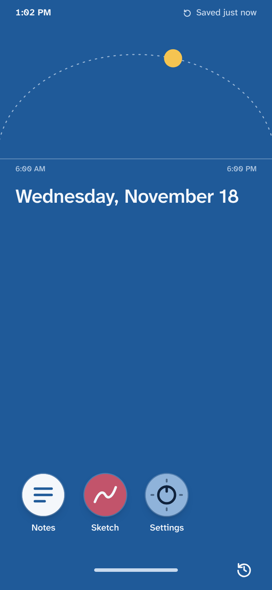
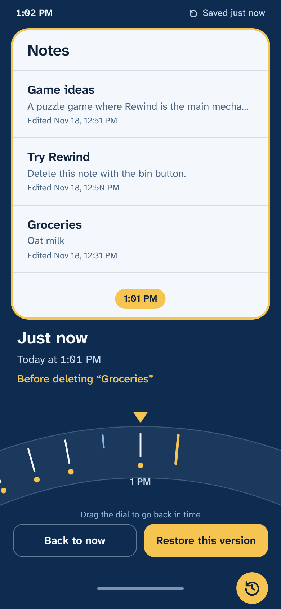
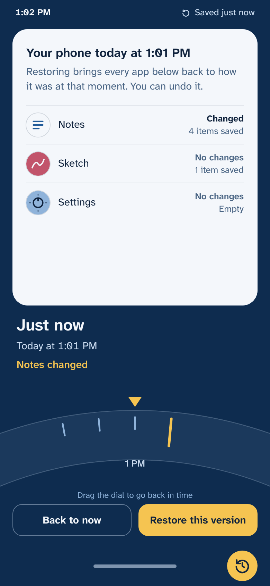
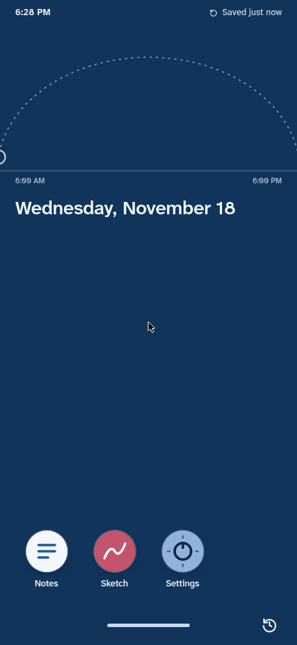

# Hindsight

Hindsight is a prototype phone operating system built around one feature:
**Rewind**. Every app's data is kept on its own Btrfs subvolume, the phone
saves a snapshot every minute while something changes, and you can turn a
dial to see any app as it was earlier, then restore it. Restoring is undoable.

<p>
  
  
  
</p>

It runs on Linux (Alpine) with its own interface, app model and app SDK.
Nothing in it comes from iOS or Android. Every build is booted in an
emulator by CI, which checks Rewind on the real disk image and saves a
screenshot of the phone's screen:



## Try it

**In the emulator (the real OS).** Download `hindsight-emulator` from the
latest [Actions build](../../actions/workflows/build.yml) or a
[release](../../releases), unzip it, install [QEMU](https://www.qemu.org/download/),
and run `run-windows.bat`, `run-mac.sh` or `run-linux.sh`. `README.txt` in the
zip walks through it.

**In your browser (quickest for working on apps).** Needs Python 3.9+:

```sh
python3 -m hindsightd --dev          # Windows: tools\dev-windows.bat
# then open http://127.0.0.1:7070
```

Dev mode uses folder copies instead of Btrfs snapshots; everything else is the same.

Then: open **Notes**, delete the "Try Rewind" note, tap the **Rewind** button
(bottom right) and drag the dial to the right.

## How it fits together

| Part | What it is |
| --- | --- |
| [`hindsightd/`](hindsightd) | System service in Python (no dependencies): app storage, Rewind snapshots, the HTTP API, and serving the interface |
| [`shell/`](shell) | The phone interface: home screen, app hosting, the Rewind dial |
| [`sdk/`](sdk) | `hindsight.js` and `hindsight.css` for apps |
| [`apps/`](apps) | Built-in apps: Notes, Sketch, Settings |
| [`image/`](image) | Builds the bootable disk image (Alpine Linux 3.24, Btrfs root, cage + Chromium kiosk) |
| [`tests/`](tests) | Engine and API tests; Btrfs tests run on a real loop-mounted volume |
| [`tools/e2e/`](tools/e2e) | Drives the interface in headless Chrome: delete, rewind, restore, undo |

- [How Rewind works](docs/REWIND.md)
- [Building apps](docs/SDK.md)
- [Roadmap](docs/ROADMAP.md): Android apps through Waydroid, running on a OnePlus 6

## Building the image yourself

On Linux, as root, with `btrfs-progs` and `qemu-utils` installed:

```sh
sudo ./image/build.sh dist        # ~5-10 minutes, downloads ~400 MB
sudo ./image/boot-test.sh dist    # boots it headless, checks Rewind, saves a screenshot
./dist/run-linux.sh
sudo ./image/patch.sh dist        # after changing apps or the shell: update the disk in seconds
```

GitHub Actions does the same on every push to `main`. Publishing a release on
GitHub (or pushing a tag like `v0.2.0`) attaches the emulator zip to it.

## Running the tests

```sh
sudo python3 -m unittest discover -s tests -v    # root only needed for the Btrfs tests
cd tools/e2e && npm install && node rewind.test.mjs
```

## Status

This is a prototype. It's missing things a phone needs: calls, Wi-Fi
settings, notifications, a lock screen, and app isolation (apps can currently
read each other's storage). See the [roadmap](docs/ROADMAP.md).
